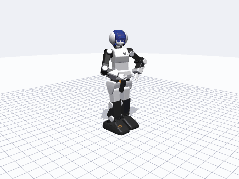

# PreMaid AI description — URDF, MuJoCo, web simulator

Everything you need to simulate and drive the **PreMaid AI** hobby humanoid (25 Kondo ICS servos): URDF / xacro, a MuJoCo model with sensors, a single-file **web simulator**
(MuJoCo WASM, `.pma` motion player and editor, real-robot link), Python loaders, glTF, ROS 1 + ROS 2 packages and an RL environment.

## Quick start

| I want to … | do this |
|---|---|
| try it in the browser | open `index.html` (or `web/premaid-sim.html`); install it as an app (works offline) |
| use it from Python | `pip install ".[mujoco]"` in a checkout (PyPI release: the CI `publish` job, see `pyproject.toml`) → `import premaidai_description as pm; model = pm.load_mujoco()` |
| load it in MuJoCo / Menagerie | `menagerie/premaid_ai/scene.xml` (visual meshes, collision hulls, sensors, keyframes, cameras) |
| use the URDF | `urdf/premaidai.urdf` (plain, `package://premaidai_description/meshes/…`) or `robots/premaidai.urdf.xacro` (ROS 1) |
| use it in Blender / Unity | `export/premaidai.glb` (zero pose, joint hierarchy, Y-up) + `export/premaidai_joints.json` |
| use ROS 2 | `ros2/premaidai_description`, `ros2/premaidai_moveit_config` (ros2_control mock / Gazebo / MoveIt 2 — static checks only, not run on ROS 2 here) |
| train a policy | `rl/` (Gymnasium env, numpy PPO, ONNX export, runs in the simulator) |
| drive the real robot | simulator → *Robot* tab: Web Serial (Chrome/Edge) or WebSocket bridge (`tools/ws_bridge.py`: Safari / iOS / Raspberry Pi) |

## The web simulator

* MuJoCo physics in the browser, 25 position servos, push test, IK handles, sensor HUD (IMU, foot force, torque, CoM trail), stand assist.
* `.pma` player with the ten bundled motions: loops, per-servo speed/stretch, A-B loop, playlist / shuffle / auto-next, share links (`#m=…&t=…&cam=…`), kiosk / embed mode, WebM + GIF recording.
* Motion editor: record keyframes, insert / duplicate / trim / split / merge, onion skin, export `.pma` and CSV.
* Real robot: 0x1F built-in motions (20 buttons), servo status table, digital twin, teach by hand, left/right follow, serial monitor, auto-reconnect, always-visible E-stop (Esc).
* Gamepad / keyboard teleop, in-browser AI policy, webcam arm mocap (MediaPipe; runtime untested), English / 中文 / 日本語 UI, keyboard shortcuts (`?`).

## Documentation

* [PROTOCOL.md](PROTOCOL.md) — serial protocol, servo ids and ranges, built-in motions, `.pma` format
* [CALIBRATION.md](CALIBRATION.md), [TROUBLESHOOTING.md](TROUBLESHOOTING.md)
* [rl/README.md](../rl/README.md) — RL pipeline (and the honest result of the demo policy)
* `web/README_sim.md` — simulator internals (Chinese), `README.md` — full repository guide (Chinese)

## Licence

Apache-2.0. ROS 1 model by chikuta, meshes by kuroiwasi, MJCF / simulator / tooling by arthurson. PreMaid AI is a product of its makers; this is an unofficial community model.
