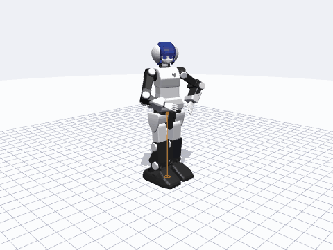

# プリメイドAI ディスクリプション — URDF・MuJoCo・Web シミュレータ

ホビー用ヒューマノイド **プリメイドAI**（近藤 ICS サーボ 25 軸）をシミュレート・操作するための一式です。URDF / xacro、センサ付き MuJoCo モデル、単一ファイルの **Web シミュレータ**
（MuJoCo WASM、`.pma` モーションプレーヤー／エディタ、実機接続）、Python ローダ、glTF、ROS 1 / ROS 2 パッケージ、強化学習環境を含みます。

## クイックスタート

| やりたいこと | 方法 |
|---|---|
| ブラウザで試す | `index.html`（または `web/premaid-sim.html`）を開く。アプリとしてインストールすればオフラインでも動きます |
| Python から使う | チェックアウトで `pip install ".[mujoco]"`（PyPI リリースは CI の `publish` ジョブ）→ `import premaidai_description as pm; model = pm.load_mujoco()` |
| MuJoCo / Menagerie 形式 | `menagerie/premaid_ai/scene.xml`（ビジュアルメッシュ、コリジョン凸包、センサ、キーフレーム、カメラ） |
| URDF | `urdf/premaidai.urdf`（汎用）／ `robots/premaidai.urdf.xacro`（ROS 1） |
| Blender / Unity | `export/premaidai.glb`（ゼロ姿勢・関節階層・Y-up）と `export/premaidai_joints.json` |
| ROS 2 | `ros2/premaidai_description`、`ros2/premaidai_moveit_config`（ros2_control モック／Gazebo／MoveIt 2。ここでは静的チェックのみで、ROS 2 上では未実行） |
| 方策を学習する | `rl/`（Gymnasium 環境、numpy PPO、ONNX 書き出し、シミュレータ内で実行） |
| 実機を動かす | シミュレータの「実機」タブ：Web Serial（Chrome／Edge）または WebSocket ブリッジ（`tools/ws_bridge.py`：Safari／iOS／Raspberry Pi） |

## Web シミュレータ

* ブラウザ内の MuJoCo 物理、25 軸の位置サーボ、押しテスト、IK ハンドル、センサ HUD（IMU・足裏力・トルク・重心軌跡）、安定化アシスト。
* 同梱 10 曲の `.pma` プレーヤー：ループ、サーボごとの速度／ストレッチ、A-B ループ、プレイリスト／シャッフル／自動再生、共有リンク（`#m=…&t=…&cam=…`）、キオスク／埋め込み、WebM／GIF 録画。
* モーションエディタ：キーフレーム記録、挿入・複製・前後トリム・分割・結合、オニオンスキン、`.pma` と CSV の書き出し。
* 実機：内蔵モーション（0x1F、20 ボタン）、サーボ状態表、デジタルツイン、手で動かして記録（ティーチ）、左右フォロー、シリアルモニタ、自動再接続、常時表示の緊急停止（Esc）。
* ゲームパッド／キーボード操作、ブラウザ内 AI ポリシー、Web カメラによる腕のモーキャプ（MediaPipe。実行部分は未検証）、日本語／English／中文 UI、キーボードショートカット（`?`）。

## ドキュメント

* [PROTOCOL.md](PROTOCOL.md) — シリアルプロトコル、サーボ ID と範囲、内蔵モーション、`.pma` 形式（英語）
* [CALIBRATION.md](CALIBRATION.md)、[TROUBLESHOOTING.md](TROUBLESHOOTING.md)（英語）
* [rl/README.md](../rl/README.md) — 強化学習パイプライン（デモ方策の結果も正直に記載）
* `web/README_sim.md`（中国語）、`README.md`（リポジトリ全体のガイド、中国語）

## ライセンス

Apache-2.0。ROS 1 モデル：chikuta、メッシュ：kuroiwasi、MJCF／シミュレータ／ツール：arthurson。プリメイドAIは各権利者の製品であり、これは非公式のコミュニティモデルです。
