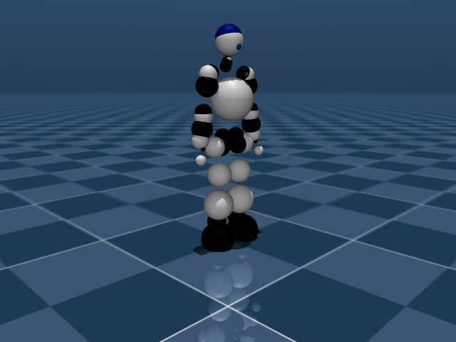

# PreMaid AI (プリメイドAI) Description (MJCF)

> [!NOTE]
> This is a community model: the robot is a hobby humanoid; the URDF is `chikuta/premaidai_description`, the meshes are by kuroiwasi, the MJCF conversion
> by arthurson ([premaidai_description](https://github.com/arthurson/premaidai_description), which also ships a browser simulator with a `.pma` motion player).

## Overview

A 25-servo (Kondo ICS) hobby humanoid, 1.80 kg in this model. The MJCF is generated from the URDF by `mujoco/make_premaid_mjcf.py` of the source repository.

<p float="left">
  
</p>

## Model details

| | |
|---|---|
| Degrees of freedom | 25 hinge joints (+ 6 for the free base) |
| Joints | head 3, each arm 5, each leg 6 |
| Actuators | 25 `position` servos: `kp` 20, `kv` 0.5, torque limit 0.91 N·m, joint damping 0.05, armature 0.005 |
| Sensors | IMU (`imu_gyro`, `imu_acc`, `imu_quat`), foot `touch` sensors (`r_foot_touch`, `l_foot_touch`), `com`, `pos_<joint>` and `tau_<joint>` for every joint |
| Keyframes | `t_pose` (all joints 0), `arms_down`, `squat` |
| Cameras | `front`, `back`, `left`, `right`, `top`, `iso` (all look at `base_link`; the robot faces +x) |
| Sites | `imu`, `r_sole`, `l_sole`, `r_foot_touch`, `l_foot_touch`, `r_hand_tip`, `l_hand_tip` |
| Collision | one convex hull per link (`*_hull.stl`, group 3); visual meshes are in group 2 |

The inertial parameters come straight from the URDF, whose inertia tensors are not all physically consistent; the model therefore sets
`balanceinertia="true"`. With the three keyframes the robot stands without any controller (it tips over at about a 9 N / 0.1 s side push).

## Usage

```python
import mujoco
m = mujoco.MjModel.from_xml_path("scene.xml")
d = mujoco.MjData(m)
mujoco.mj_resetDataKeyframe(m, d, 1)     # arms_down
```

`ctrl[i]` is the target angle (rad) of the i-th position servo (head_ny, head_nz, head_nx, right arm, left arm, right leg, left leg).

## Changelog

See [CHANGELOG.md](CHANGELOG.md).

## License

Apache-2.0 (see `LICENSE`; the meshes carry their own copy in `assets/LICENSE.txt`, also Apache-2.0).
